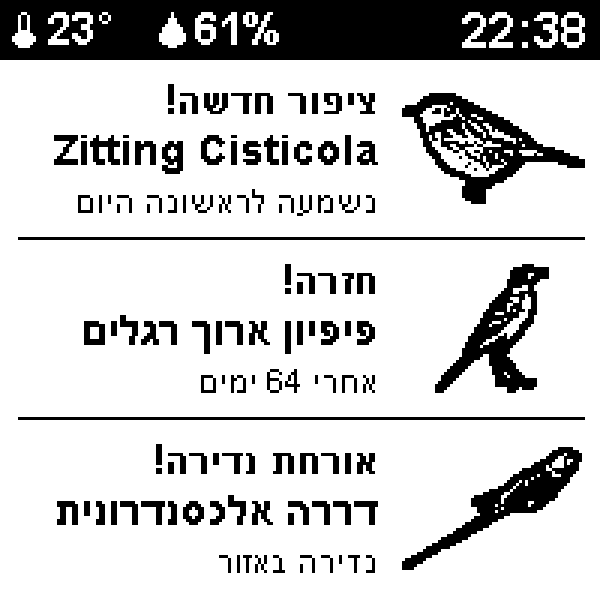

# BirdNET Kids display

A small desk display that shows the birds heard most recently by a [BirdNET-Pi](https://github.com/Nachtzuster/BirdNET-Pi)
bird-sound station, built for kids: a photo of the bird, its Hebrew and English name, how often it was
heard this week, and when. Hold a button and it plays the bird's recording.

It reads the public files of the BirdNET Kids website (a separate project) over Wi-Fi, so it works on
any network and needs nothing running at home. It is built to run for weeks on a small battery.

## Devices

| Folder | Hardware | Status |
|---|---|---|
| [`devices/esp32-s3-epaper-1.54`](devices/esp32-s3-epaper-1.54) | Waveshare ESP32-S3-ePaper-1.54: 200x200 black-and-white e-paper, temperature and humidity sensor, battery, two buttons, speaker | working |
| [`devices/esp32-c6-touch-amoled-1.43`](devices/esp32-c6-touch-amoled-1.43) | Waveshare ESP32-C6-Touch-AMOLED-1.43: round colour touch screen | idea only |

Each device is a self-contained folder with its firmware, tools and notes.

## What the e-paper display does

- **The bird screen:** cut-out photo, Hebrew name and English name, "heard 17 times this week", badges
  (resident, migrant, raptor, ...), "7 minutes ago", and a top bar with temperature, humidity, a plug or
  battery symbol and the time.
- **The today screen:** weekday and date in Hebrew, a weather picture with the day's highest and lowest,
  today's temperature graph with the chance of rain, and a box left free for daily notes.
- **Only confident, complete birds:** species the site marks "Low confidence", and species with no photo or
  Hebrew name yet, are never shown.
- **Buttons:** BOOT short = other screen; BOOT held = play the bird's song (the green LED blinks);
  PWR short = next bird; PWR held = refresh now. The bird also changes by itself every 20 minutes.
- **Sleeps almost all the time**, waking every 20 minutes and using Wi-Fi once an hour. Details, memory use, Wi-Fi behaviour,
  offline behaviour and battery estimates: [`HOW_IT_WORKS.md`](devices/esp32-s3-epaper-1.54/HOW_IT_WORKS.md).

A mockup of a planned "news" screen (new bird, welcome back), not built yet:



## How the pictures are made

The e-paper only has black and white, so each bird is cut out of its photo with a segmentation model
(U2-Net, run on your PC), cropped tight, and dithered into dots. Photos come from Wikimedia Commons.
All birds are stored on the device, so photos never travel over Wi-Fi. A tool helps find better
photos and compare before and after (`tools/find_photos.py`).

## Build and flash (Windows, Linux or macOS)

You need Python 3.10+, [PlatformIO Core](https://platformio.org) 6.2 or newer, and a USB cable.
On Windows run `pio` from PowerShell, not Git Bash.

```bash
python -m venv .venv && . .venv/bin/activate          # Windows: .venv\Scripts\activate
pip install platformio pillow python-bidi numpy scipy "rembg[cpu]"

cd devices/esp32-s3-epaper-1.54
cp firmware/include/secrets.example.h firmware/include/secrets.h   # then put your 2.4 GHz Wi-Fi in it
python tools/build_pack.py          # downloads the photos, cuts the birds out, writes firmware/data/cards
cd firmware
pio run -e bird_display -t upload   # the firmware
pio run -e bird_display -t uploadfs # the bird pack
```

`secrets.h` is git-ignored: your Wi-Fi password is never committed. The first run downloads a 176 MB
segmentation model. More notes (flashing a sleeping board, test builds): the device's `CLAUDE.md`.

## Where the data comes from

Public, read-only files of the BirdNET Kids website (`data.json`, `news.json`, the audio clips) from GitHub, and
once an hour today's weather forecast from [Open-Meteo](https://open-meteo.com) (free, no key; weather data by
Open-Meteo.com, CC BY 4.0). [`docs/data-contract.md`](docs/data-contract.md) lists exactly what is used. The
device sends no personal data: only HTTPS requests, and to Open-Meteo the station's location rounded to about
5 km.

## Licence

The source code is [MIT](LICENSE). The bird photos, and the compiled firmware (which links GPL-3.0
libraries), have their own terms: see [`THIRD_PARTY.md`](THIRD_PARTY.md) before you distribute either.
